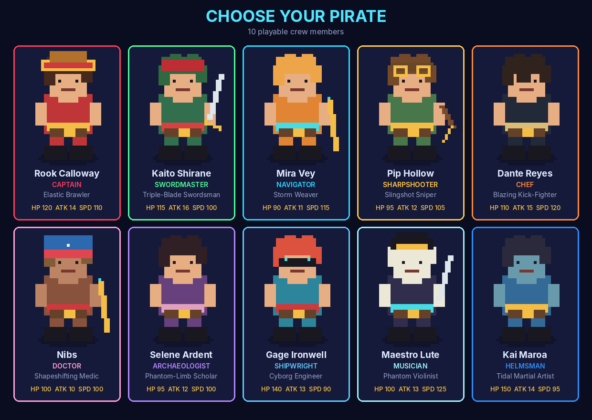
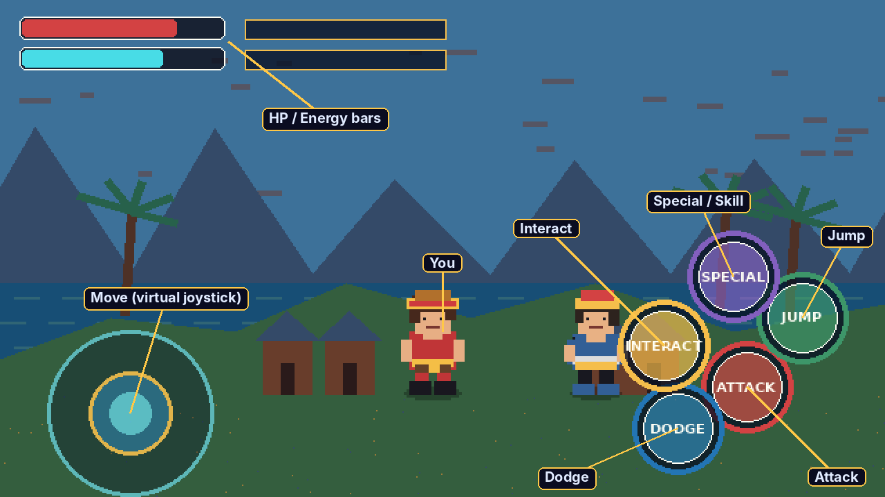
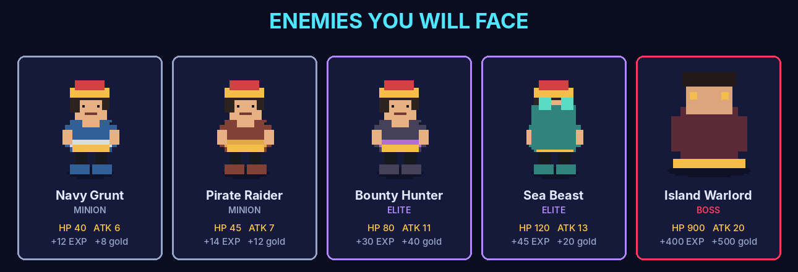
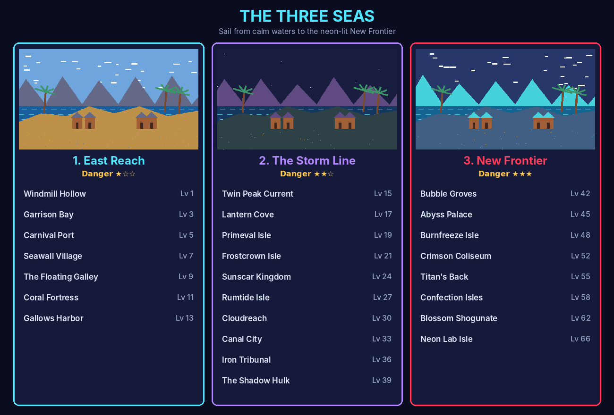
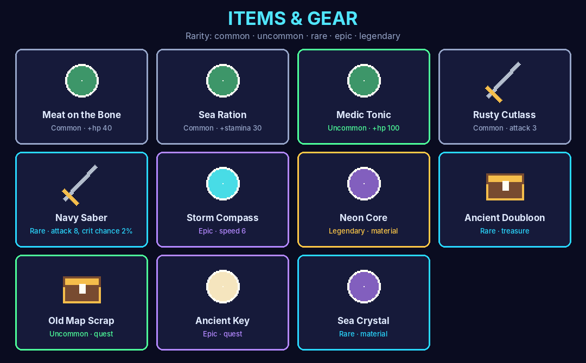

# Neon Tides: Pirate Legacy — Player's Guide

Welcome aboard! **Neon Tides: Pirate Legacy** is an offline, retro-futuristic pixel-art pirate action RPG for Android. Choose a crew member, fight across 25 islands in three seas, level up, collect gear, and sail toward the neon-lit New Frontier.

> **Build status.** The current build (v0.1.0) has the foundation in place: the title screen, system check, settings, and the save system. Combat, menus, sailing, and the inventory arrive in later updates. Sections marked 🚧 describe features that are designed in the game data but not playable yet.

---

## Contents

1. [Installing and starting the game](#1-installing-and-starting-the-game)
2. [Choosing your pirate](#2-choosing-your-pirate)
3. [Controls](#3-controls)
4. [Your stats and leveling up](#4-your-stats-and-leveling-up)
5. [Enemies and bosses](#5-enemies-and-bosses)
6. [The world: three seas, 25 islands](#6-the-world-three-seas-25-islands)
7. [Items and gear](#7-items-and-gear)
8. [Saving and loading](#8-saving-and-loading)
9. [Settings](#9-settings)
10. [Troubleshooting and FAQ](#10-troubleshooting-and-faq)

---

## 1. Installing and starting the game

**On Android**

1. Copy `NeonTides.apk` to your phone and open it. Allow installing from this source if your phone asks.
2. Launch **Neon Tides**. The game runs in landscape and keeps the screen awake while you play.
3. The game needs **no internet connection** and does not request the internet permission.

**On a computer (Godot 4.3+)**: open `project.godot` in the Godot editor and press **F5**.

### The title screen

The game opens on the title screen shown at the top of this guide. **Tap anywhere** (or press Enter or Space) to continue. It also moves on by itself after 4 seconds.

### The system check

On first launch the **System Check** screen tests that saving, storage, audio, and game data all work on your device. A healthy phone shows **"29 / 29 SYSTEMS ONLINE"**.

- **RE-RUN** runs the checks again.
- **TITLE** returns to the title screen.
- **GALLERY** previews the game's characters, enemies, and islands in motion.

If any line is red, see [Troubleshooting](#10-troubleshooting-and-faq).

---

## 2. Choosing your pirate

When you start a **New Game** you pick one of ten crew members. Each has a different fighting style, starting stats, and skill set. Everyone starts at **level 1** with **100 gold** and **3 × Meat on the Bone**.

| Crew member | Role | Plays like | Good for |
|---|---|---|---|
| **Rook Calloway** (Captain) | Elastic Brawler | Long-reach stretchy punches from the Coil-Coil Fruit | All-round beginners |
| **Kaito Shirane** (Swordmaster) | Triple-Blade Swordsman | Highest attack, strong critical hits | Aggressive melee |
| **Mira Vey** (Navigator) | Storm Weaver | Lightning from a storm staff, large energy pool | Ranged spell-casting |
| **Pip Hollow** (Sharpshooter) | Slingshot Sniper | Trick ammo, 18% crit chance | Keeping your distance |
| **Dante Reyes** (Chef) | Blazing Kick-Fighter | Fast, fiery kicks | Speed and combos |
| **Nibs** (Doctor) | Shapeshifting Medic | Transforms with the Beast Fruit | Flexible play |
| **Selene Ardent** (Archaeologist) | Phantom-Limb Scholar | Spectral arms from any surface (Bloom Fruit) | Crowd control |
| **Gage Ironwell** (Shipwright) | Cyborg Engineer | High HP, cola-powered gadgets | Tanky fighting |
| **Maestro Lute** (Musician) | Phantom Violinist | Very fast, frost-edged rapier (Echo Fruit) | Hit-and-run |
| **Kai Maroa** (Helmsman) | Tidal Martial Artist | Highest HP, ocean-powered palm strikes | Standing your ground |

**Fruit users** (Rook, Nibs, Selene, Lute) have special powers but are weakened by **Sea Crystal**.

You start with your character's first skill. More skills unlock as you level up. 🚧

---

## 3. Controls

### Touch controls (Android) 🚧

| On screen | What it does |
|---|---|
| **Joystick** (bottom left) | Move. Push further to run. |
| **ATTACK** | Basic attack. Tap repeatedly to combo. |
| **JUMP** | Jump. |
| **DODGE** | Quick dash with a moment of invulnerability. Costs stamina. |
| **SPECIAL** | Use a skill. Costs energy. |
| **INTERACT** | Talk to people, open chests, board your ship. |
| **Phone back button** | Close the current menu or go back. |

You can resize the buttons, change their opacity, and switch to a **left-handed** layout in **Settings → Controls**.

### Keyboard and gamepad

| Action | Keyboard | Gamepad |
|---|---|---|
| Move | **W A S D** or **arrow keys** | Left stick |
| Jump | **Space** or **K** | **A** |
| Attack | **J** | **X** |
| Dodge | **L** or **Shift** | **B** |
| Block | **Q** | **LB** |
| Skill 1 / 2 / 3 | **U** / **I** / **O** | D-pad ← / ↑ / → |
| Ultimate | **R** | **RB** |
| Interact | **E** | **Y** |
| Pause | **P** | **Start** |
| Back | **Esc** or **Backspace** | **Back / Select** |

---

## 4. Your stats and leveling up

The bars in the top-left corner show your **HP** (red) and **Energy** (cyan).

| Stat | Meaning |
|---|---|
| **HP** | Health. At zero you are knocked out. |
| **Attack** | Damage dealt by your hits and skills. |
| **Defense** | Reduces damage you take. |
| **Speed** | How fast you move. |
| **Stamina** | Spent on dodging and running. Refills over time. |
| **Energy** | Spent on skills and your ultimate. |
| **Crit chance** | Chance that a hit deals extra damage. |

**Leveling up.** Defeat enemies to earn **EXP**. Every level raises all of your stats. The max level is **99**. A big EXP reward can give several levels at once.

| Level | EXP needed for the next level |
|---|---|
| 1 | 100 |
| 5 | about 585 |
| 10 | about 1,650 |
| 25 | about 6,960 |
| 50 | about 21,000 |

---

## 5. Enemies and bosses

| Tier | What to expect |
|---|---|
| **Minion** | Common and weak. Good for EXP and gold. |
| **Elite** | Tougher and faster. Watch their attacks and dodge. |
| **Boss** | Guards an island. Bosses fight in **3 phases** and get more dangerous as they lose health. |

**Tips** 🚧

- Dodge *through* attacks. The dash makes you briefly invulnerable.
- Save your energy for skills when an elite or boss is open to attack.
- Eat **Meat on the Bone** before a boss fight, not halfway through it.

---

## 6. The world: three seas, 25 islands

Your journey begins in **Windmill Hollow** in the East Reach. Each island has a **recommended level**. You can visit it earlier, but expect a hard fight.

| Sea | Danger | Islands | Levels |
|---|---|---|---|
| **East Reach** | ★☆☆ | 7 | 1–13 |
| **The Storm Line** | ★★☆ | 10 | 15–39 |
| **New Frontier** | ★★★ | 8 | 42–66 |

You travel between islands on your ship 🚧:

---

## 7. Items and gear

| Type | Examples | Use |
|---|---|---|
| **Food and healing** | Meat on the Bone (+40 HP), Medic Tonic (+100 HP), Sea Ration (+30 stamina), Energy Cola (+50 energy) | Use from the inventory or quick slot |
| **Weapon** | Rusty Cutlass (+3 ATK), Navy Saber (+8 ATK, +2% crit) | Equip in the weapon slot |
| **Armor** | Deckhand Vest (+3 DEF) | Equip in the armor slot |
| **Accessory** | Storm Compass (+6 SPD) | Equip in the accessory slot |
| **Material** | Driftwood, Sea Crystal, Neon Core | Ship repairs and crafting |
| **Treasure** | Ancient Doubloon | Sell for gold |
| **Quest** | Old Map Scrap, Ancient Key | Kept for quests. Can't be sold. |

Rarity, from most to least common: **common → uncommon → rare → epic → legendary**. The frame color around an item shows its rarity.

---

## 8. Saving and loading

| Slot | How it's used |
|---|---|
| **Autosave** | The game saves automatically every 3 minutes, and whenever you switch apps, lock the phone, or close the game. |
| **Slots 1–3** | Manual saves you choose. 🚧 |

- **Continue** on the main menu loads your most recent save.
- Each save shows your character, level, island, gold, and play time.
- Every save keeps a **backup**. If a save file is damaged, the game detects it and restores the backup on its own.

---

## 9. Settings

| Section | Option | Default |
|---|---|---|
| **Audio** | Master / Music / Sound effects / Interface volume | 100% / 80% / 90% / 80% |
| **Display** | Frame rate limit (30 or 60 FPS) | 60 |
| | V-Sync | On |
| | Show FPS counter | Off |
| | Screen shake | On |
| **Controls** | Button size | 100% |
| | Button opacity | 75% |
| | Left-handed layout | Off |
| | Vibration | On |
| **Gameplay** | Autosave | On, every 3 minutes |
| | Difficulty (Easy / Normal / Hard) | Normal |

**Saving battery:** set the frame rate to **30 FPS** and turn off vibration.

---

## 10. Troubleshooting and FAQ

**Does the game need internet?**
No. Everything runs offline, and the app doesn't ask for internet access.

**The System Check shows a red line.**
Tap **RE-RUN**. If storage or saving still fails, make sure your phone has free storage space and restart the game.

**I lost progress after closing the game.**
The game autosaves when you leave it. If the newest save was damaged, the game loads the backup, which may be a few minutes older.

**The game is laggy or my phone gets warm.**
Set the frame rate limit to **30 FPS** in Settings → Display.

**The buttons are too small or in the way.**
Change **Button size** and **Button opacity** in Settings → Controls, or turn on the left-handed layout.

---

*Fair winds, captain. The New Frontier is waiting.* 🏴‍☠️

The figures in this guide are built from the game's own art and data by [`make_figures.py`](make_figures.py). Run `python3 docs/user_guide/make_figures.py` to rebuild them after the data changes.
